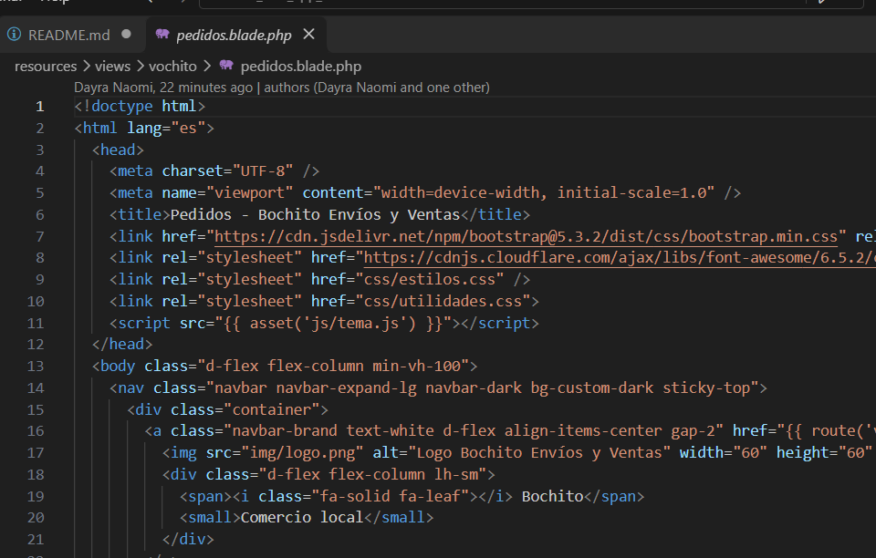

# Bochito – Envíos y Ventas

Aplicación web CRUD hecha con **Laravel 12** y **PostgreSQL** para gestionar los **productos** de tiendas locales y los **pedidos** de los clientes. Incluye validación del lado del servidor, mensajes en español, búsqueda, filtros, paginación y modo oscuro.

## Funcionalidades

**Productos** (`/productos`)
- Alta, edición y eliminación, con búsqueda por nombre y paginación de 10 registros.
- No permite nombres repetidos.
- Un producto con pedidos no se puede eliminar. La app muestra un mensaje controlado en vez de un error.
- Los productos inactivos no aparecen en el catálogo ni al registrar pedidos.

**Pedidos** (`/pedidos`)
- Alta, edición y cancelación (eliminación), con confirmación antes de borrar.
- Filtros por cliente, estatus y rango de fechas de entrega.
- Cambio rápido de estatus desde la tabla: Orden recibida → En fabricación → Control de calidad → Empaquetado → En tránsito.
- Validación de campos obligatorios, de cantidades (de 1 a 1000) y de la fecha de entrega, que debe ser futura al registrar.

**Catálogo** (`/catalogo`): tarjetas con los productos activos, leídos de la base de datos.

**Otros módulos del equipo**
- **Incidencias** (`/incidencias`): registro y seguimiento de problemas en los pedidos.
- **Notificaciones** (`/notificaciones`): avisos del sistema.
- **Evidencias** (`/evidencias`): evidencias de entrega.

**Cuentas y usuarios**
- **Inicio de sesión** (`/iniciar-sesion`) y **registro** (`/registro`), con contraseñas cifradas y un límite de 5 intentos por minuto.
- **Usuarios** (`/usuarios`): solo para administradores. Permite buscar, editar, dar o quitar el permiso de administrador y eliminar cuentas.
- `php artisan migrate --seed` crea un administrador y un cliente de prueba. Sus correos y su contraseña están en `database/seeders/DatabaseSeeder.php`.

## Tecnologías

| Herramienta | Versión |
|---|---|
| PHP | 8.2 o superior |
| Laravel | 12 |
| PostgreSQL | 17 |
| Bootstrap | 5.3 |
| Font Awesome | 6.5 |

## Instalación

1. Clona el repositorio y entra a la carpeta:

   ```bash
   git clone https://github.com/naomivimid-lang/Vochito_Lara_app_2026.git
   cd Vochito_Lara_app_2026
   ```

2. Instala las dependencias de PHP:

   ```bash
   composer install
   ```

3. Copia el archivo de entorno y genera la llave de la aplicación:

   ```bash
   cp .env.example .env
   php artisan key:generate
   ```

   En Windows PowerShell, usa `Copy-Item .env.example .env` en lugar de `cp`.

4. Crea la base de datos en PostgreSQL:

   ```sql
   CREATE DATABASE laravel;
   ```

   Después, en `.env`, ajusta `DB_USERNAME` y `DB_PASSWORD` con tu usuario de PostgreSQL. El archivo `.env` no se sube al repositorio.

5. Crea las tablas y carga los datos de ejemplo (10 productos del catálogo, con un pedido cada uno):

   ```bash
   php artisan migrate --seed
   ```

6. Inicia el servidor y abre `http://127.0.0.1:8000`:

   ```bash
   php artisan serve
   ```

Para reiniciar la base con los datos de ejemplo, corre `php artisan migrate:fresh --seed`. Este comando borra todos los registros.

## Estructura (MVC)

```
app/
├── Http/Controllers/
│   ├── ProductoController.php    CRUD de productos y catálogo
│   └── PedidoController.php      CRUD de pedidos y cambio de estatus
├── Http/Requests/                Validaciones con mensajes en español
│   ├── StoreProductoRequest.php / UpdateProductoRequest.php
│   ├── StorePedidoRequest.php   / UpdatePedidoRequest.php
│   └── ActualizarEstatusRequest.php
└── Models/
    ├── Producto.php              hasMany pedidos
    └── Pedido.php                belongsTo producto, lista de estatus
database/
├── migrations/                   tablas productos y pedidos (llave foránea)
├── factories/ProductoFactory.php
└── seeders/ProductoSeeder.php
resources/views/
├── layouts/app.blade.php         menú, encabezado y pie comunes
├── partials/flash.blade.php      mensajes de éxito y error
├── productos/                    index, create, edit, _form
├── pedidos/                      index, create, edit, _form
└── vochito/                      páginas informativas y catálogo
routes/web.php
```

## Base de datos

| Tabla | Campos principales |
|---|---|
| `productos` | `nombre` (único), `descripcion`, `precio` decimal(10,2), `stock`, `activo` |
| `pedidos` | `cliente`, `producto_id` (llave foránea que impide borrar el producto), `cantidad`, `entrega`, `estatus` |

## Rutas principales

| Método | URL | Acción |
|---|---|---|
| GET | `/productos` | Lista y búsqueda de productos |
| GET / POST | `/productos/create`, `/productos` | Registrar producto |
| GET / PUT | `/productos/{id}/edit`, `/productos/{id}` | Editar producto |
| DELETE | `/productos/{id}` | Eliminar producto |
| GET | `/pedidos` | Lista y filtros de pedidos |
| GET / POST | `/pedidos/create`, `/pedidos` | Registrar pedido |
| GET / PUT | `/pedidos/{id}/edit`, `/pedidos/{id}` | Editar pedido |
| PATCH | `/pedidos/{id}/estatus` | Cambiar estatus |
| DELETE | `/pedidos/{id}` | Cancelar pedido |
| GET | `/catalogo` | Catálogo de productos activos |
| GET / POST / PUT / DELETE | `/incidencias` | CRUD de incidencias |
| GET / POST / PUT / DELETE | `/notificaciones` | CRUD de notificaciones |
| GET / POST / PUT / DELETE | `/evidencias` | CRUD de evidencias |

Puedes ver la lista completa con `php artisan route:list`.

## Seguridad

- Todos los formularios llevan `@csrf`, y los métodos PUT, PATCH y DELETE se envían con `@method`.
- La validación ocurre en el servidor, con FormRequests.
- Las consultas usan Eloquent con parámetros enlazados, sin SQL concatenado.
- Las vistas imprimen con `{{ }}`, que escapa el HTML.
- Las credenciales solo viven en `.env`, que está en `.gitignore`.

## Equipo

| Integrante | Responsabilidad |
|---|---|
| Miguel Angel Guerrero Lopez(MAngelGL777) 2531126234 | Migraciones, modelos, validaciones y CRUD de productos y pedidos |
| Vital Millán Dayra Naomi | |
| Carpio Campos Rodrigo | |
| Ortiz Salguero Geazul Guadalupe | |
| Lorenzana Hernández Aarón Dahir | Cancelaciones, modificaciones, reporte de desempeño, layouts y rutas resource |

## Evidencia




**Vochito Laravel – Proyecto académico 2026.**


---

## Aportaciones de Lorenzana Hernández Aarón Dahir

### Issue #7 (Aarón): Cancelaciones, modificaciones y reportes

**Interfaces trabajadas:**

- `cancelacion.blade.php`
- `modificacion.blade.php`
- `reporte_desempeno.blade.php`

**Actividades realizadas:**

- Registro de solicitudes de cancelación y de modificación de pedidos.
- Consulta de las solicitudes realizadas en una tabla con filtro por estado (Pendiente, Aprobada, Rechazada).
- Actualización del estado de las solicitudes (aprobar, rechazar o reabrir).
- Eliminación de solicitudes cuando corresponde.
- Regla de negocio: no se permite cancelar ni modificar un pedido con estatus "En tránsito".
- Búsqueda en vivo del pedido al escribir la orden de compra (PO).
- Generación de reportes por rango de fechas, con atajos (7 días, 30 días, este año, histórico).
- Indicadores de pedidos entregados a tiempo, retrasados y cancelados, con porcentaje de efectividad y tabla de desglose.

**Controladores:** `SolicitudController.php` y `ReporteController.php`.

### Issue #16 (Aaron2): Estructura del backend

- **Migraciones y modelos:** tabla `solicitudes` (`2026_11_18_100000_create_solicitudes_table.php`) y modelo `Solicitud` integrado con `Pedido`, `Producto`, `Incidencia` y `Evidencia`.
- **Relaciones:** un `Pedido` tiene muchas `Solicitudes` (`hasMany`), y cada `Solicitud` pertenece a un `Pedido` (`belongsTo` por `pedido_id`).
- **Validaciones de formularios** con Form Requests y mensajes en español:
  `StoreSolicitudRequest`, `UpdateSolicitudRequest` y `GenerarReporteRequest`.
- **Rutas RESTful** organizadas con `Route::resource()` para solicitudes y reportes integradas con `productos` y `pedidos`.
- **Layout y formularios reutilizables:**
  - `layouts/app.blade.php` y `partials/flash.blade.php` integrados en las vistas de cancelación, modificación y reportes.
  - `partials/form_solicitud.blade.php` (mismo formulario reutilizable para cancelación y modificación).
- **Seeder** con datos de prueba (`SolicitudSeeder.php` integrado en `DatabaseSeeder.php`).

### Ejecución de migraciones y datos de prueba

Después de configurar la base de datos en el archivo `.env`:

```bash
php artisan migrate --seed
```
