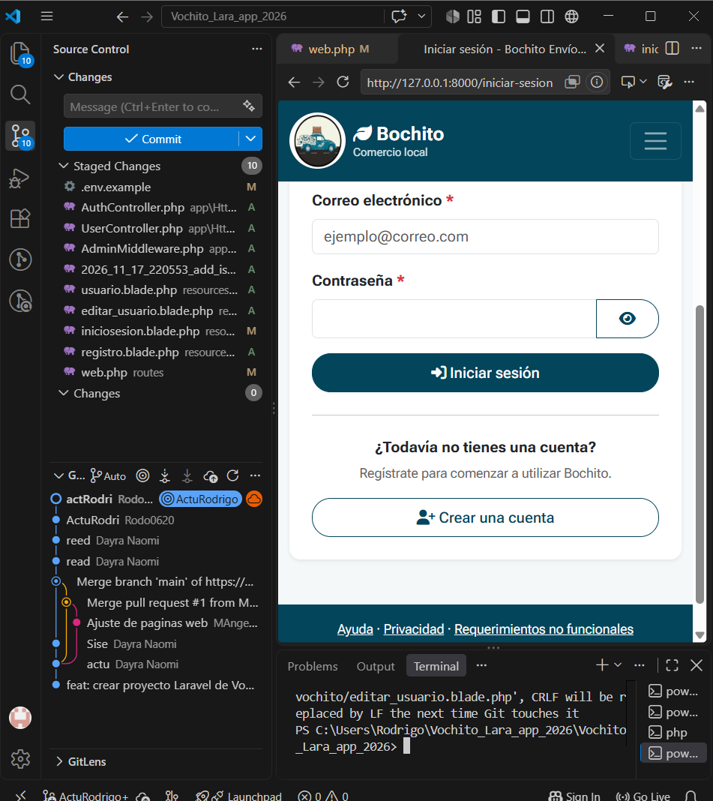
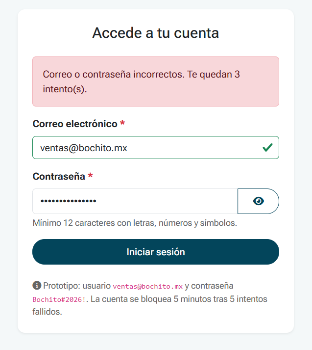
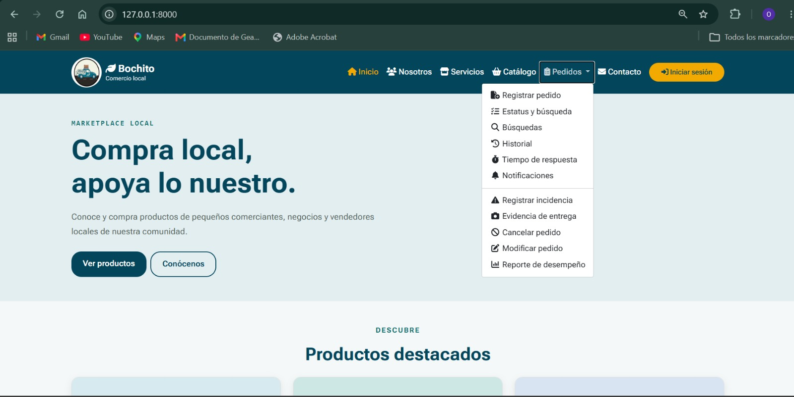
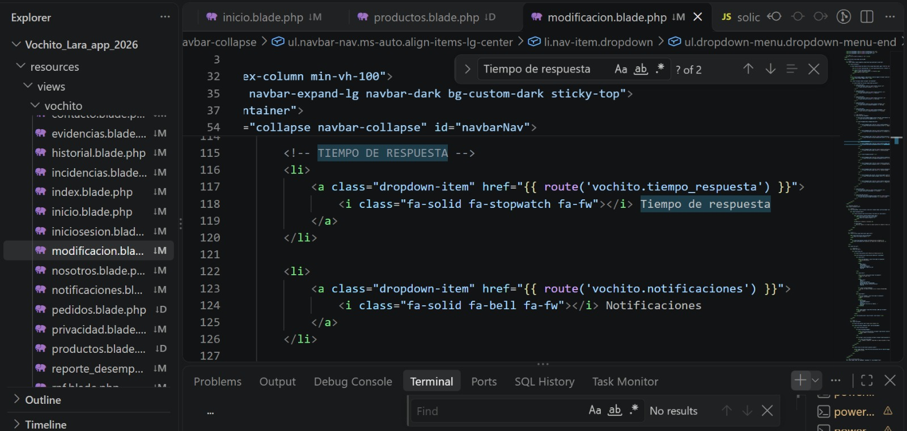

# VOCHITO – Envíos y Ventas

## Descripción del proyecto

**VOCHITO** es una aplicación web desarrollada con Laravel 12 que adapta el sistema original de Vochito a una estructura basada en el patrón Modelo-Vista-Controlador (MVC).

El sistema está enfocado en la gestión de productos y pedidos de tiendas locales, además de contar con módulos para el seguimiento y administración de las operaciones.

El proyecto forma parte de una práctica académica orientada al desarrollo web, el uso de rutas, vistas Blade, controladores, peticiones HTTP y operaciones CRUD.

## Objetivo

Desarrollar una aplicación web con Laravel que permita administrar productos y pedidos, conservar las interfaces del proyecto original y aplicar operaciones CRUD mediante una estructura organizada.

## Tecnologías utilizadas

- PHP 8.2 o superior.
- Laravel 12.
- Blade.
- PostgreSQL.
- HTML5 y CSS3.
- JavaScript.
- Bootstrap 5.3.
- Font Awesome 6.5.
- Git y GitHub.
- Visual Studio Code.

## Funcionalidades

### Productos

- Registrar productos.
- Consultar el listado de productos.
- Editar información de los productos.
- Eliminar productos.
- Buscar productos por nombre.
- Consultar el catálogo de productos activos.
- Evitar nombres de productos duplicados.
- Impedir eliminar productos que tengan pedidos relacionados.

### Pedidos

- Registrar pedidos.
- Consultar pedidos registrados.
- Editar información de los pedidos.
- Cancelar pedidos.
- Filtrar por cliente, estatus y fechas de entrega.
- Actualizar el estatus de los pedidos.
- Validar cantidades y fechas de entrega.

### Usuarios y autenticación

- Inicio de sesión.
- Registro de usuarios.
- Cierre de sesión.
- Administración de usuarios.
- Edición y eliminación de cuentas.
- Control de permisos de administrador.
- Validación de credenciales.

### Otros módulos

- Búsquedas e historial.
- Incidencias.
- Notificaciones.
- Evidencias de entrega.
- Cancelaciones y modificaciones.
- Reportes de desempeño.
- Tiempo de respuesta.
- Contacto y ayuda.
- Requerimientos no funcionales.

## Estructura del proyecto

```text
Vochito_Lara_app_2026/
├── app/
│   ├── Http/
│   │   ├── Controllers/
│   │   ├── Middleware/
│   │   └── Requests/
│   └── Models/
├── database/
│   ├── migrations/
│   └── seeders/
├── public/
│   ├── css/
│   ├── js/
│   └── img/
├── resources/
│   └── views/
│       ├── layouts/
│       ├── partials/
│       └── vochito/
├── routes/
│   └── web.php
├── .env.example
├── composer.json
└── README.md
```

## Operaciones CRUD

Los módulos que administran registros utilizan las operaciones correspondientes:

| Método HTTP | Operación | Descripción                                                        |
| ----------- | --------- | ------------------------------------------------------------------ |
| GET         | Read      | Consultar registros.                                               |
| POST        | Create    | Registrar nuevos registros.                                        |
| PUT         | Update    | Modificar registros existentes.                                    |
| DELETE      | Delete    | Eliminar registros.                                                |
| PATCH       | Update    | Actualizar parcialmente un registro, como el estatus de un pedido. |

No todos los módulos requieren las cuatro operaciones; por ejemplo, las búsquedas y los reportes se enfocan principalmente en consultas.

## Base de datos

La aplicación utiliza modelos y migraciones para organizar la información.

Entre las tablas utilizadas se encuentran:

| Tabla       | Información                                                 |
| ----------- | ----------------------------------------------------------- |
| productos   | Nombre, descripción, precio, stock y estado.                |
| pedidos     | Cliente, producto relacionado, cantidad, entrega y estatus. |
| solicitudes | Solicitudes de cancelación y modificación.                  |
| users       | Información de usuarios y permisos.                         |

La relación entre productos y pedidos se establece mediante la llave foránea `producto_id`. Las solicitudes se relacionan con los pedidos mediante `pedido_id`.

## Instalación y ejecución

### 1. Clonar el repositorio

```bash
git clone https://github.com/naomivimid-lang/Vochito_Lara_app_2026.git
```

### 2. Entrar a la carpeta

```bash
cd Vochito_Lara_app_2026
```

### 3. Instalar dependencias

```bash
composer install
```

### 4. Configurar el archivo de entorno

En PowerShell:

```powershell
Copy-Item .env.example .env
```

### 5. Generar la clave de Laravel

```bash
php artisan key:generate
```

### 6. Configurar PostgreSQL

Crear una base de datos y configurar las credenciales correspondientes en el archivo `.env`.

Ejemplo:

```env
DB_CONNECTION=pgsql
DB_HOST=127.0.0.1
DB_PORT=5432
DB_DATABASE=laravel
DB_USERNAME=tu_usuario
DB_PASSWORD=tu_contraseña
```

### 7. Ejecutar las migraciones y los datos de prueba

```bash
php artisan migrate --seed
```

### 8. Iniciar el servidor

```bash
php artisan serve
```

Abrir en el navegador:

```text
http://127.0.0.1:8000
```

---

# Participaciones de los integrantes

## MI PARTE

**Nombre:** Rodrigo Carpio Campos.

### Actividades desarrolladas

Durante el desarrollo del proyecto VOCHITO – Envíos y Ventas, participé en la implementación y configuración de las siguientes funcionalidades:

- **Módulo de autenticación:** implementación del inicio y cierre de sesión de usuarios.
- **Registro de usuarios:** creación de la funcionalidad para registrar nuevas cuentas.
- **CRUD de usuarios:** implementación de las operaciones para consultar, editar y eliminar usuarios.
- **Control de acceso:** configuración de permisos para restringir el acceso al administrador.
- **Controladores:** desarrollo y modificación de `AuthController` y `UserController`.
- **Rutas:** configuración de rutas para el registro, inicio de sesión y administración de usuarios.
- **Vistas Blade:** trabajo en las interfaces de inicio de sesión, registro y administración de usuarios.
- **Validaciones:** implementación de validaciones para nombres, correos electrónicos y contraseñas.

### Objetivo de mi participación

Contribuir al desarrollo de la aplicación mediante la implementación de funcionalidades de autenticación y administración de usuarios, aplicando el patrón MVC de Laravel, las operaciones CRUD y el uso de Git para el control de versiones.

### Capturas de pantalla de MIAS

#### Página principal





---

## Módulo de Cancelaciones, Modificaciones y Reportes

**Nombre:** Lorenzana Hernández Aarón Dahir.

### Actividades desarrolladas

- **Cancelaciones y modificaciones (`/cancelacion`, `/modificacion`):** registro, consulta, filtrado por estado, aprobación, rechazo y eliminación de solicitudes mediante `SolicitudController`, usando un formulario reutilizable (`partials/form_solicitud.blade.php`) integrado al layout principal (`layouts/app.blade.php`).
- **Validaciones y regla de negocio:** validación en el servidor con `StoreSolicitudRequest` y `UpdateSolicitudRequest`; bloqueo de solicitudes cuando el pedido ya está en estatus _En tránsito_ y cambio automático del pedido a _Cancelado_ al aprobar una cancelación.
- **Reporte de desempeño (`/reporte-desempeno`):** cálculo de pedidos entregados a tiempo, retrasados y cancelados por rango de fechas mediante `ReporteController` y `GenerarReporteRequest`.
- **Base de datos y rutas:** migración `solicitudes` con relación `belongsTo` / `hasMany` hacia `Pedido` (`pedido_id`), rutas RESTful con `Route::resource()` y datos de prueba en `SolicitudSeeder`.

---

## Mi participación: Integración del apartado Tiempo de respuesta

**Nombre:** Geazul Guadalupe Ortiz Salguero.

### Actividades desarrolladas

Durante el desarrollo del proyecto VOCHITO – Envíos y Ventas, participé en la integración del acceso al apartado de Tiempo de respuesta dentro de la interfaz principal del sistema.

Las actividades realizadas fueron:

- **Integración del botón:** incorporación de la opción Tiempo de respuesta en el menú desplegable de Pedidos.
- **Navegación de la interfaz:** organización del acceso para que los usuarios puedan localizar y abrir el apartado desde la pantalla principal.
- **Vinculación de rutas:** conexión de la opción del menú con la ruta `vochito.tiempo_respuesta`.
- **Integración de la vista Blade:** vinculación del acceso con la vista `tiempo_respuesta.blade.php`.
- **Organización de la interfaz:** mejora de la navegación del sistema mediante la incorporación de una opción dentro del menú de Pedidos.

### Objetivo de mi participación

Facilitar el acceso al apartado de Tiempo de respuesta mediante su integración en el menú desplegable de Pedidos, mejorando la organización y navegación de la interfaz del sistema.

### Aportación al proyecto

Mi contribución se enfocó en la navegación de la aplicación web y la integración de una nueva opción en la interfaz principal, utilizando las rutas de Laravel y las vistas Blade para conectar los elementos visuales con las secciones correspondientes del sistema.




