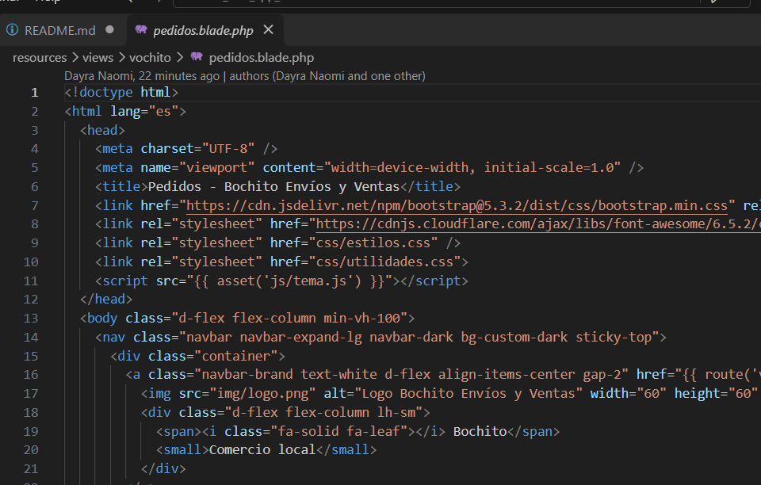

# Vochito Laravel

## Descripción del proyecto

**Vochito Laravel** es un proyecto web desarrollado con el framework Laravel y PHP, que consiste en la adaptación del sistema Vochito a una estructura basada en el patrón de vistas Blade.

El proyecto tiene como finalidad trasladar la interfaz del sistema original Vochito a Laravel, conservar su diseño y organizar sus recursos para facilitar su mantenimiento y futuras modificaciones.

Además, forma parte de una práctica académica enfocada en el uso de las peticiones HTTP y las operaciones CRUD (Crear, Leer, Actualizar y Eliminar).

## Objetivo

Desarrollar una aplicación web utilizando Laravel que permita comprender y aplicar el funcionamiento de las rutas, vistas Blade, controladores y métodos HTTP mediante un proyecto basado en el sistema Vochito.

## Tecnologías utilizadas

- **PHP:** lenguaje de programación del lado del servidor.
- **Laravel 12:** framework para el desarrollo de la aplicación.
- **Blade:** motor de plantillas de Laravel para organizar las vistas.
- **HTML5:** estructura de las páginas web.
- **CSS3:** estilos y diseño visual.
- **JavaScript:** interactividad y funcionalidades del prototipo.
- **Bootstrap 5:** diseño adaptable y componentes de interfaz.
- **Git y GitHub:** control de versiones y trabajo colaborativo.
- **Visual Studio Code:** entorno de desarrollo.

## Estructura del proyecto

```text
Vochito_Lara_app_2026/
│
├── app/
│   └── Http/
│       └── Controllers/
│
├── public/
│   ├── css/
│   ├── js/
│   └── img/
│
├── resources/
│   └── views/
│       └── vochito/
│           ├── inicio.blade.php
│           ├── nosotros.blade.php
│           ├── servicios.blade.php
│           ├── catalogo.blade.php
│           ├── busquedas.blade.php
│           ├── pedidos.blade.php
│           ├── productos.blade.php
│           └── ...
│
├── routes/
│   └── web.php
│
├── database/
├── composer.json
├── package.json
└── README.md
```

## Funcionalidades y secciones

El sistema conserva diferentes apartados del proyecto original Vochito:

- **Inicio:** página principal del sistema.
- **Nosotros:** información general del proyecto.
- **Servicios:** presentación de los servicios disponibles.
- **Catálogo:** sección de consulta de productos.
- **Búsquedas:** apartado para localizar información.
- **Pedidos:** consulta y administración de pedidos del prototipo.
- **Productos:** sección destinada a la gestión de productos.
- **Historial:** consulta de registros anteriores.
- **Notificaciones:** avisos del sistema.
- **Incidencias:** registro y consulta de problemas.
- **Evidencias:** apartado para consultar evidencias.
- **Cancelación y modificación:** secciones relacionadas con las solicitudes de los pedidos.
- **Contacto y ayuda:** información de asistencia al usuario.
- **Requerimientos:** documentación de los requerimientos no funcionales.

## Peticiones HTTP y operaciones CRUD

Uno de los propósitos principales de este proyecto es aplicar las operaciones CRUD mediante las peticiones HTTP:

| Método HTTP | Operación  | Descripción                     |
| ----------- | ---------- | ------------------------------- |
| GET         | Leer       | Consultar información.          |
| POST        | Crear      | Registrar nuevos elementos.     |
| PUT         | Actualizar | Modificar registros existentes. |
| DELETE      | Eliminar   | Borrar registros.               |

La práctica busca demostrar estas operaciones utilizando las herramientas de Laravel, sus rutas y vistas Blade, sin depender de una base de datos en esta etapa del proyecto.

## Instalación y ejecución

Para ejecutar el proyecto de manera local, sigue estos pasos:

**1. Clonar el repositorio**

```bash
git clone https://github.com/naomivimid-lang/Vochito_Lara_app_2026.git
```

**2. Entrar a la carpeta**

```bash
cd Vochito_Lara_app_2026
```

**3. Instalar las dependencias de PHP**

```bash
composer install
```

**4. Crear el archivo de configuración**

En Windows PowerShell:

```powershell
Copy-Item .env.example .env
```

**5. Generar la clave de Laravel**

```bash
php artisan key:generate
```

**6. Iniciar el servidor**

```bash
php artisan serve
```

**7. Abrir el proyecto**

En el navegador ingresa al enlace que te muestre el resultado del php

## 🌐 Rutas principales

Las siguientes son algunas de las rutas configuradas en Laravel:

| Ruta              | Vista            |
| ----------------- | ---------------- |
| `/`               | Inicio           |
| `/nosotros`       | Nosotros         |
| `/servicios`      | Servicios        |
| `/catalogo`       | Catálogo         |
| `/busquedas`      | Búsquedas        |
| `/pedidos`        | Pedidos          |
| `/productos`      | Productos        |
| `/historial`      | Historial        |
| `/notificaciones` | Notificaciones   |
| `/incidencias`    | Incidencias      |
| `/contacto`       | Contacto         |
| `/iniciar-sesion` | Inicio de sesión |

## Trabajo colaborativo

El desarrollo de este proyecto se realiza mediante Git y GitHub, permitiendo que los integrantes del equipo puedan colaborar, realizar modificaciones, actualizar archivos y compartir avances.

Cada colaborador puede aportar mejoras al diseño, las funcionalidades y la organización del proyecto mediante commits y actualizaciones del repositorio.

## Alcance del proyecto

Esta versión está enfocada en la adaptación del sistema Vochito a Laravel y en el aprendizaje de sus herramientas principales.

La práctica contempla el uso de vistas Blade, rutas web, controladores y operaciones CRUD, utilizando datos de prueba y sin implementar una conexión a una base de datos.

## 👩‍💻 Equipo

- Vital Millán Dayra Naomi
- Guerrero López Miguel Ángel
- Carpio Campos Rodrigo
- Ortiz Salguero Geazul Guadalupe
- Lorenzana Hernández Aarón Dahir

## Evidencia

## 


**Vochito Laravel – Proyecto académico 2026.**
