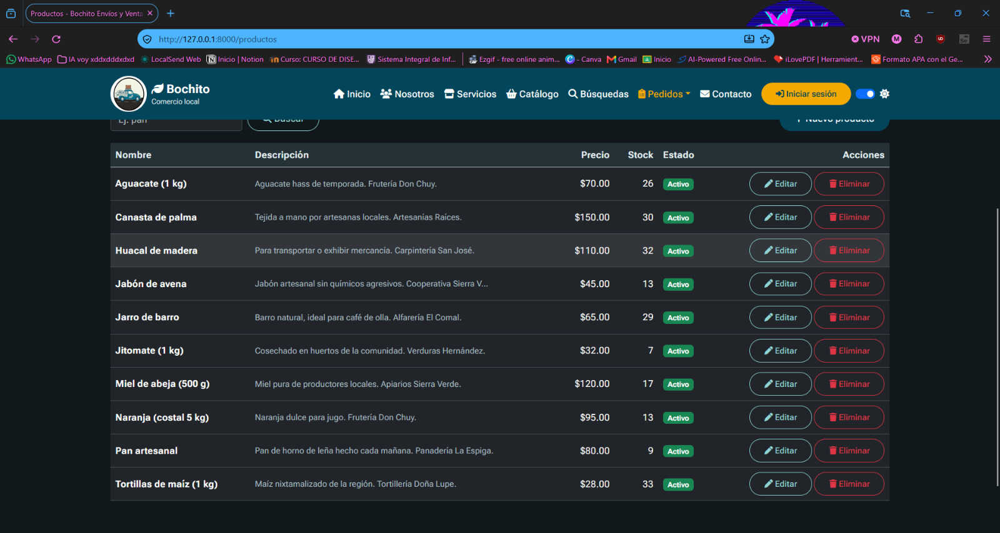
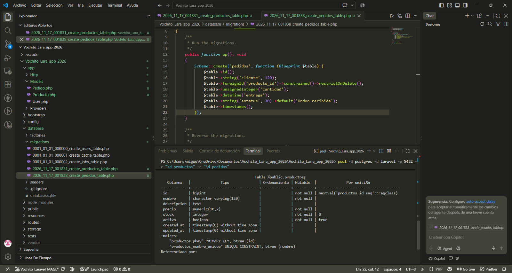
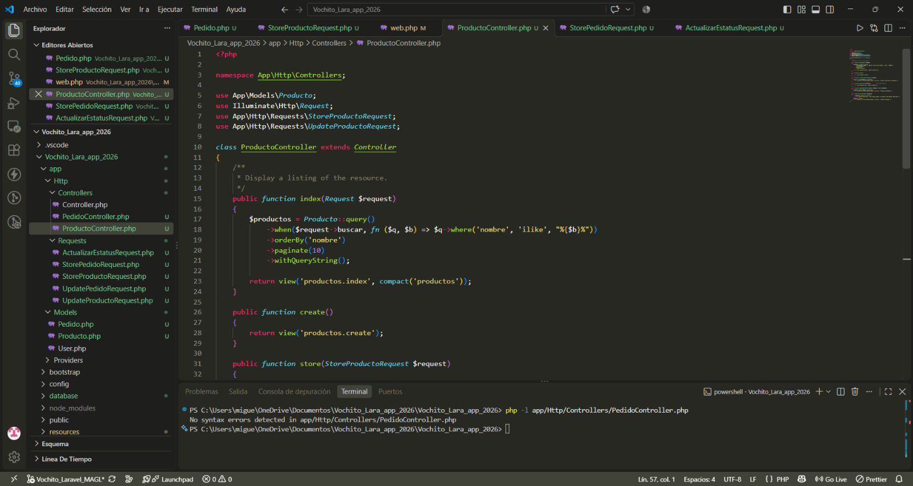

# Bochito – Envíos y Ventas

Es una app web hecha con **Laravel 12** y **PostgreSQL** para llevar los **productos** de las tiendas locales y los **pedidos** de los clientes. Tiene altas, ediciones, bajas, búsqueda, filtros, paginación, mensajes en español y modo oscuro.



## ¿Qué hace?

- **Productos** (`/productos`): puedes crear, editar, eliminar y buscar por nombre. No se repiten nombres, y si un producto ya tiene pedidos no te deja borrarlo (te avisa con un mensaje).
- **Pedidos** (`/pedidos`): puedes crear, editar y cancelar. Filtras por cliente, estatus o fechas, y cambias el estatus directo desde la tabla.
- **Catálogo** (`/catalogo`): muestra en tarjetas los productos que están activos.

## Cómo correrlo

Necesitas PHP 8.2 o más nuevo, Composer y PostgreSQL.

```bash
git clone https://github.com/naomivimid-lang/Vochito_Lara_app_2026.git
cd Vochito_Lara_app_2026
composer install
cp .env.example .env
php artisan key:generate
```

Crea la base `laravel` en PostgreSQL y pon tu usuario y contraseña en el `.env`. Después:

```bash
php artisan migrate --seed
php artisan serve
```

Abre `http://127.0.0.1:8000`. El `--seed` mete 10 productos del catálogo y un pedido para cada uno.

> Para empezar de cero usa `php artisan migrate:fresh --seed`. Ojo: borra todo lo que haya en la base.

## Base de datos

Son dos tablas relacionadas: un producto puede tener muchos pedidos.

- **productos**: nombre (único), descripción, precio, stock y si está activo.
- **pedidos**: cliente, producto (llave foránea), cantidad, fecha de entrega y estatus.



## Cómo está organizado (MVC)

- **Modelos** (`app/Models`): `Producto` y `Pedido`, con su relación.
- **Controladores** (`app/Http/Controllers`): `ProductoController` y `PedidoController`.
- **Validaciones** (`app/Http/Requests`): una por formulario, con mensajes en español.
- **Vistas** (`resources/views`): un layout común y las carpetas `productos/` y `pedidos/`.
- **Rutas** (`routes/web.php`): `Route::resource` para los dos CRUD y una ruta extra para cambiar el estatus. Las ves todas con `php artisan route:list`.



## Seguridad

- Todos los formularios llevan `@csrf`.
- Se valida en el servidor, no solo en el navegador.
- Las consultas usan Eloquent, sin armar SQL a mano.
- Las contraseñas solo van en el `.env`, que no se sube a GitHub.

## Equipo

| Integrante | Qué hizo |
|---|---|
| Miguel (MAngelGL777) | Migraciones, modelos, validaciones y CRUD de productos y pedidos |
| _(nombre)_ | _(qué hizo)_ |
| _(nombre)_ | _(qué hizo)_ |
